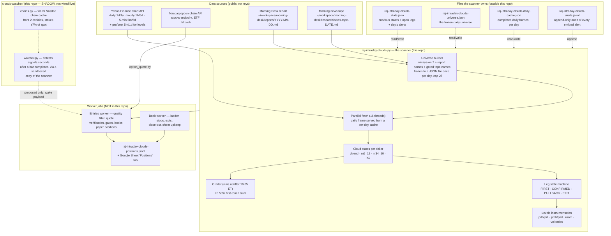
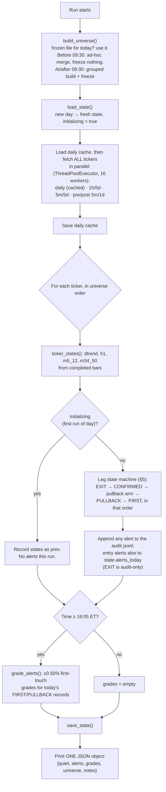
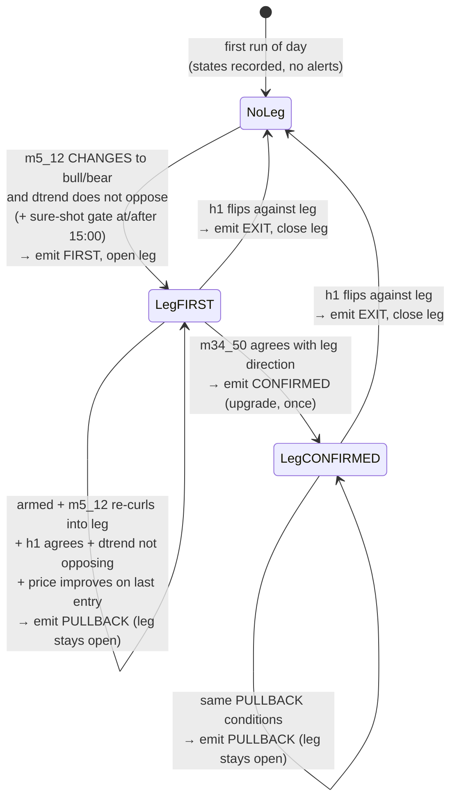

# Raj Intraday Clouds — the complete system, documented end to end

This repository contains the code for **Raj Intraday Clouds**: an intraday
alert scanner built on Raj's own EMA-cloud logic, running on 5-minute
candles. It watches a universe of liquid US stocks/ETFs, detects cloud
signals (entries, confirmations, pullback re-entries, exits), and prints
one JSON object per run that downstream worker jobs turn into paper
trades and chat cards.

This README is written so that **anyone can pick the system up cold**:
what it is, how every number is calculated (from the raw bar up to the
final signal), how the pieces fit together, every threshold in the code,
how to run it, and — just as important — what the code does **not** do.
Every formula, period, threshold and field name below was taken from the
source files in this repo and re-verified against them line by line.

---

## 0. Safety facts — read these first

- **Paper / shadow only.** Nothing in this repo places a real trade,
  talks to a broker, or sends an order anywhere. The scanner prints
  signals; separate worker jobs (not in this repo) paper-track them.
- **The scanner never books anything.** It has no concept of a position,
  a premium, a spread gate, a cooldown, or an account balance. All
  booking rules live in the consuming worker jobs (§11 explains the
  exact boundary).
- **The code in this repo is frozen in production.** The live file
  `raj-intraday-clouds.py` is treated as read-only; changes are built as
  *candidate* files, tested, and swapped in only on Raj's explicit word.
  The file map in §10 says exactly which file is live.
- **No API keys, no accounts.** Market data comes from two public,
  unauthenticated endpoints (Yahoo Finance chart API, Nasdaq option
  chain API). They are unofficial and can lag, throttle, or change
  shape without notice (§11).

---

## 1. What the system is

Raj's trading method uses **EMA clouds**: pairs of exponential moving
averages plotted as a band. A pair is *bullish* when the fast EMA is
above the slow EMA **and still rising** ("curling up"), *bearish* when
the fast EMA is below the slow EMA **and still falling** ("curling
down"), and *flat* otherwise. The intraday system stacks four cloud
readings per ticker, from four timeframe/pair combinations:

| Reading | Pair | Bars | Role in the system |
|---|---|---|---|
| `m5_12` | EMA 5 / EMA 12 | 5-minute | The trigger. A fresh curl fires entries. |
| `m34_50` | EMA 34 / EMA 50 | 5-minute | The strengthener. Agreement upgrades an entry to CONFIRMED. |
| `h1` | EMA 8 / EMA 21 | 1-hour | Hold guidance. A flip against an open leg fires EXIT. |
| `dtrend` | EMA 20/21 + EMA 50/55 cross-check | Daily | Day bias. A FIRST entry may not fight it. |

On top of the four readings sits a small **leg state machine** (§5):
a FIRST signal opens a *leg*, a 34/50 agreement upgrades it to
CONFIRMED, a 5/12 pullback-and-re-curl inside the leg can fire extra
PULLBACK entries, and a 1-hour flip closes the leg with an EXIT.

The scanner runs once every ~5 minutes during market hours (driven by
an external scheduler; the script itself is a one-shot program). Each
run fetches fresh bars for the whole universe in parallel, recomputes
the four states per ticker, diffs them against the previous run's
states kept in a state file, emits any signal records, grades the day's
earlier entries after the close, and prints exactly one JSON object.

**Who it is for:** Raj (the trader whose rules these are) and any
engineer or agent who has to operate, debug, or extend the lane without
breaking it. If you are changing anything, read §10 (which file is
live) and §11 (what the code does not do) before you touch a line.

---

## 2. Architecture



Three programs live in this repo:

1. **`raj-intraday-clouds.py`** — the scanner. One-shot: run it, it
   prints one JSON object, it exits. All persistent memory is in the
   three JSON files + audit log it maintains in
   `~/workspace/goals/morning-trading-desk/hidden_files/`.
2. **`option_quote.py`** — a standalone command-line tool that fetches
   a live Nasdaq option chain and picks the best contract for a
   direction/entry/target (§6). The worker jobs call it to price paper
   entries; the scanner itself calls it for each tape name that
   reaches the spread gate during the morning universe build (§4.3).
3. **`clouds-watcher/`** — a shadow-mode latency package (§7):
   `watcher.py` re-runs the scanner in a sandbox the moment each 5-min
   bar completes so signals are *detected* in seconds, and `chains.py`
   keeps a warm option-chain cache. It writes nothing outside its own
   folder and is **not wired into the live lane** — it observes and
   logs proof only.

### One scanner run, step by step



Two properties worth knowing before anything else:

- **The scanner never raises.** Any per-ticker failure is caught, noted
  (`"<ticker>: data error this run — skipped."`), and the run
  continues. A fatal failure prints a quiet JSON object with a
  `"fatal: ..."` note and the always-on universe.
- **Diagnostics go to stderr, data to stdout.** Stdout carries exactly
  one JSON object; log lines (`[raj-clouds HH:MM:SS] ...`) go to
  stderr.

---

## 3. The math, from the ground up

### 3.1 Bars — where the numbers come from

All price data comes from Yahoo Finance's public chart API
(`yahoo_bars()` in the scanner):

```
https://query1.finance.yahoo.com/v8/finance/chart/<TICKER>?interval=<iv>&range=<rg>&events=div%2Csplit
```

- A fetch returns parallel arrays (timestamps + open/high/low/close/
  volume), which become a pandas DataFrame indexed by UTC time. Rows
  with a missing Close are dropped; fewer than 5 rows = fetch failure.
- Failures retry up to **3 attempts** (15 s timeout each, sleeping
  1 s, then 3 s between attempts). After that the ticker's series is
  `None` for the run.
- Per ticker, each run fetches four series:

| Series | Interval / range | Used for |
|---|---|---|
| Daily | `1d` / `1y` | `dtrend`, pdh/pdl, day-pace denominator |
| Hourly | `1h` / `5d` | `h1` |
| 5-minute | `5m` / `5d` | `m5_12`, `m34_50`, prices, grading, volume |
| 5-min pre/post | `5m` / `1d`, `includePrePost=true` | pmh/pml only (levels, §5.6) |

**Completed bars.** `completed(df, bar_len)` converts the index to
America/New_York time and drops the last bar **if** `bar start +
bar length > now` — i.e. a still-forming bar is removed. It drops at
most one bar. Two consequences, both deliberate and documented in the
code:

- **Daily bars** are stamped 09:30 ET, so `09:30 + 1 day > now` is true
  all day: today's daily bar is *always* dropped, and the daily frame
  is exactly the completed sessions through yesterday. This is what
  makes the per-day daily cache (§8.3) provably safe.
- **1h / 5m bars:** Yahoo's response also carries an appended live
  quote point stamped at fetch time. `completed()` drops *that* point,
  which leaves the still-forming regular bar in the frame as its last
  row. So the last 5-minute bar the states and prices are computed
  from is the **currently forming bar, with live values** — entries
  fire intrabar by design (the levels code calls the frame's last row
  "the still-forming entry bar"). If Yahoo does not append the quote
  point on a given response, the forming bar itself is dropped
  instead. Either way, the rule in code is exactly one drop decision,
  made on the final row only.

**EMAs are computed over the whole fetched window**, not reset per
session: the 5/12 cloud at 09:35 ET is the tail of an EMA series that
runs back over the full 5 days of 5-minute bars, and likewise for the
hourly (5 days) and daily (1 year) series.

### 3.2 The EMA — exact definition

```python
def ema(s, n):
    return s.ewm(span=n, adjust=False).mean()
```

That is pandas' recursive exponential moving average:

- Smoothing factor **α = 2 / (n + 1)**.
- Seeded with the first value: `EMA₁ = close₁`.
- Then `EMA_t = α · close_t + (1 − α) · EMA_{t−1}`.

There is no SMA warm-up period and no minimum-history adjustment
inside `ema()` itself; the warm-up guards live in `ticker_states()`
(§3.4), which refuses to compute a state until enough closes exist.

### 3.3 The cloud state — what "bull", "bear", "flat" and "curl" mean in code

One function decides every cloud reading (`_cloud_state(fast, slow)`,
where `fast`/`slow` are two EMA series over the same closes):

```
bull  if  fast[last] > slow[last]  AND  fast[last] > fast[prev]
bear  if  fast[last] < slow[last]  AND  fast[last] < fast[prev]
flat  otherwise
```

- **"Curl" is the second condition.** Being above the slow EMA is not
  enough: the fast EMA must also be *moving* in that direction between
  the last two bars. Fast above slow but falling = `flat`. Fast below
  slow but rising = `flat`. Fast exactly equal to slow, or fast
  unchanged between bars = `flat`.
- If any of the three values read (fast last, fast prev, slow last) is
  NaN, or anything throws, the state is `flat`.

### 3.4 The four readings — exact construction (`ticker_states()`)

| State | Fast / slow | Series | Minimum closes | Notes |
|---|---|---|---|---|
| `m5_12` | EMA 5 / EMA 12 | 5-min closes | ≥ 14 | The entry trigger cloud. |
| `m34_50` | EMA 34 / EMA 50 | 5-min closes | ≥ 52 | The confirmation cloud. |
| `h1` | EMA 8 / EMA 21 | 1-hour closes | ≥ 25 | The hold/exit cloud. |
| `dtrend` | special — see below | Daily closes | ≥ 56 | The day-bias gate. |

Below the minimum, the state stays at its default: **`flat`**.

**The daily trend is NOT a `_cloud_state` curl.** It is a separate
function (`daily_trend()`) with its own rule, copied from Raj's swing
system:

```
bull  if  EMA21(last) > EMA20(last)  AND  EMA55(last) > EMA50(last)
bear  if  EMA21(last) < EMA20(last)  AND  EMA55(last) < EMA50(last)
flat  otherwise (including fewer than 56 daily closes)
```

All four EMAs are over daily closes; only their last values are
compared; there is no rising/falling condition. The pairing looks odd
(21 vs 20, 55 vs 50) and is intentional — it is Raj's rule exactly as
specified, not a typo.

### 3.5 Worked example — a 5/12 curl, with real numbers

Take 14 consecutive completed 5-minute closes rising $1 per bar:
100, 101, 102, …, 113. Running the code's own `ema()`:

- α for EMA 5 = 2/(5+1) = **0.3333**; seeded at 100, the second value
  is 100 + 0.3333 × (101 − 100) = **100.3333**, and so on.
- EMA 5, last two values: **110.0154 → 111.0103** (rising).
- EMA 12, last value: **108.1269**.
- Check: fast last (111.0103) > slow last (108.1269) ✔ and fast last
  (111.0103) > fast prev (110.0154) ✔ → **`m5_12` = `bull`**.

If the next bar's close fell enough that EMA 5 ticked *down* while
still above EMA 12, the state would read `flat`, not `bull` — position
above the cloud is not a curl.

### 3.6 The price and stop reference on every alert

- `price` = the last value of the 5-minute Close series (after the
  `completed()` treatment above), rounded to 2 decimals.
- `ema12` = the last value of EMA 12 over the same 5-minute closes
  (computed when ≥ 12 closes exist, else `null`). Downstream cards
  show it as the signal's stop reference ("the 5m EMA12 on the other
  side of entry"). The scanner computes no other stop.
- `time` = the timestamp of the frame's last 5-minute bar, formatted
  `"YYYY-MM-DD HH:MM ET"`.

---

## 4. The universe — which tickers get scanned

Cap: **25 tickers** (`MAX_UNIVERSE`). The universe is decided once per
day and frozen; intraday runs never change it.

### 4.1 Sources, in priority order

1. **Always-on 7** (`BASE_TICKERS`): SPY, QQQ, IWM, TSLA, NVDA, MSFT,
   AMZN. Source tag `always-on`.
2. **Morning Desk report names**, parsed from today's report
   (`~/workspace/morning-desk/reports/YYYY-MM-DD.md`; if today's file
   is missing, the newest dated report in that folder). Only lines
   inside sections whose heading contains WATCHLIST, TOP IDEAS,
   TOP 3 OPPORTUNITIES, or BATTLE PLAN are considered (`##` headings
   and certain `**bold**` headings open/close sections). A ticker line
   must match:

   ```
   ^\s*(?:\d+\.\s+|-\s+)?([A-Z]{1,5})(?:\s*·|\s+—|\s+–|\s+-\s)
   ```

   i.e. an optional `1.` or `-` lead, a 1–5 letter uppercase symbol,
   then a `·`, `—`, `–`, or ` - ` separator. The words THE, AND, FOR,
   TOP, LONG, SHORT, KEY, NEW are rejected as stopwords. Separately,
   the whole file is scanned for lines matching the same ticker
   pattern that also contain "BENCH" — a parsed name found that way
   gets source tag `bench`; all other report names get `report`.
3. **News-tape names** (lowest priority; grouped build only, §4.3):
   tickers parsed from `~/workspace/morning-desk/research/news-tape-<today>.md`
   — the first cell of table rows (`| TICKER | ...`) and the leading
   ticker of bold-labelled bullets (`- **Label** TICKER ...`). The
   literal header word TICKER is skipped.

### 4.2 Before 09:30 ET — ad-hoc merge, nothing frozen

Runs before 09:30 ET use sources 1 + 2 only (deduped, capped at 25)
and write nothing to disk. Rationale in code: premarket option quotes
are stale, so the tape spread gate (§4.3) is only ever judged on live
quotes.

### 4.3 At/after 09:30 ET — the grouped build, frozen for the day

The first run at/after 09:30 ET builds the full universe and writes it
to `raj-intraday-clouds-universe.json`; every later run that day reads
the frozen file instead of rebuilding. Tape names must pass three
gates, in order, all fail-closed:

| Gate | Rule (constants) |
|---|---|
| (a) Price | Last completed daily close ≥ **$10** (`TAPE_MIN_PRICE`). Needs ≥ 20 completed daily sessions (today excluded) or the name fails with "only N completed sessions". |
| (b) Liquidity | Mean of Close × Volume over the last 20 completed sessions ≥ **$50,000,000** (`TAPE_MIN_DOLLAR_VOL`). |
| (c) Spread | A near-ATM front contract is quoted via `option_quote.py` (§6) on the LONG side at the latest 5-min close (fallback: the daily close). A real bid > 0, an ask, and a mid > 0 are required, and **(ask − bid) / mid ≤ 5%** (`TAPE_MAX_SPREAD_PCT`). The quote subprocess times out at 40 s. |

Names passing (a) + (b) are sorted by average dollar volume,
descending, and admitted through gate (c) one at a time until the cap
of 25 is reached. Every exclusion is recorded with its reason in the
frozen universe file and in the run's `notes`. Tape names are **scan
coverage only** — the scanner gives them no direction or analysis;
any entry on them still has to come through the normal signal logic.

If no tape file exists for today, the grouped universe is just
sources 1 + 2 and a note says so.

---

## 5. The signal state machine

The scanner keeps, per ticker, four pieces of state between runs
(in `raj-intraday-clouds-state.json`, §8.2):

- `prev` — the four cloud states as computed on the **previous run**
  (not the previous bar — runs are ~5 minutes apart, so in practice
  they track consecutive bars).
- `open_alert` — the open *leg*: `{dir, level, entry_price,
  entry_time, entry_time_iso}`, or `null`.
- `pb_seen` — whether a pullback has been armed inside the leg.
- `last_entry` — the price of the leg's most recent entry (FIRST or
  PULLBACK); the staircase reference.

**First run of the day:** state is re-initialized, every ticker's
states are recorded as `prev`, and **no alerts fire** — the machine
needs a previous reading before any transition means anything.

On every later run, for each ticker, the checks run **in this fixed
order**: EXIT → CONFIRMED → pullback-arm → PULLBACK → FIRST.



### 5.1 EXIT

Condition: a leg is open **and** `h1` now equals the opposite of the
leg's direction (leg LONG → `h1` = `bear`; leg SHORT → `h1` = `bull`).

The EXIT record carries the leg's original `entry_price` and
`entry_time`, with `price` = the current last close. The leg is then
closed: `open_alert = null`, `pb_seen = false`, `last_entry = null`.
EXIT is checked first, so on a run where both an EXIT and anything
else could fire, the EXIT wins and the leg is gone before the other
checks look at it. EXIT records do **not** carry the levels fields
(§5.6).

### 5.2 CONFIRMED (upgrade)

Condition: a leg is open, its level is still `FIRST`, **and**
`m34_50` now agrees with the leg's direction (`bull` for LONG, `bear`
for SHORT).

The CONFIRMED record keeps the **original FIRST entry price and entry
time** — it is an upgrade of the same signal, not a new entry — and
the leg's level becomes `CONFIRMED`, so it can fire only once per
leg. (Whether a CONFIRMED also books an *add-on position* is a worker
rule; the scanner has no add-on concept.)

### 5.3 PULLBACK — arm and fire

**Arm:** while a leg is open, any run where `m5_12` is *not* the leg's
direction (flat or flipped against) sets `pb_seen = true`. Price has
pulled back against the trend; the setup is armed.

**Fire** — all of these, on the same run:

1. A leg is open and `pb_seen` is true;
2. the **previous run's** `m5_12` was not the leg direction, and the
   **current** `m5_12` is the leg direction — the 5/12 has re-curled
   into the trade;
3. `h1` agrees with the leg direction;
4. `dtrend` does not oppose the leg (not `bear` for a LONG leg, not
   `bull` for a SHORT leg);
5. **Staircase:** the current price improves on the leg's last entry —
   LONG: `price > last_entry`; SHORT: `price < last_entry` (falling
   back to the leg's `entry_price` if `last_entry` is unset). A
   re-curl that does not progress past the last entry is chop and
   does not fire;
6. the after-3PM sure-shot gate (§5.5) does not block it.

The PULLBACK record is a **new entry at its own price** (`entry_price`
= current price, `entry_time` = current bar). The leg itself stays
open — EXIT/CONFIRMED management is unchanged — and `last_entry`
advances to the pullback price, `pb_seen` resets to false.

### 5.4 FIRST

Condition: **no leg is open**, the previous run's `m5_12` exists and
**differs** from the current `m5_12` (any state change — into or out
of `flat` counts as a change, but only a change *into* a direction can
fire), and:

- current `m5_12` = `bull` and `dtrend` ≠ `bear` → **LONG**
- current `m5_12` = `bear` and `dtrend` ≠ `bull` → **SHORT**

plus the sure-shot gate (§5.5) after 15:00. A change from `bull` to
`flat` fires nothing (the new state is not a direction). A direct
`bear` → `bull` flip with no open leg fires a LONG FIRST immediately.

On firing, a leg opens: `{dir, level: "FIRST", entry_price: price,
entry_time: bar time, entry_time_iso: bar time as ISO}`, `pb_seen =
false`, `last_entry = price`.

**What is deliberately NOT in the scanner's FIRST logic:** the lane's
quality filter (daily agrees, or daily flat with 1H agreeing, and 1H
never against) is stricter than the `dtrend`-not-opposing check above.
The scanner does not apply it. Consumers apply it to the emitted
records (and `clouds-watcher`'s `quality_pass()` mirrors it, §7.3).
A scanner FIRST is a *signal*, not an approved entry.

### 5.5 The after-3PM sure-shot gate (`_sure_shot_blocked`)

From **15:00 ET** (judged on the entry record's own bar timestamp), a
FIRST or PULLBACK may fire only when **both** `dtrend` and `h1` equal
the trade direction (`bull` for LONG, `bear` for SHORT). Flat on
either blocks it. A blocked signal is **not emitted** — it is logged
to stderr and named in the run's `notes` with the reason (e.g.
`"daily flat, 1H bull — not both bear"`), and on a blocked PULLBACK
the leg's `pb_seen` / `last_entry` are left untouched. The gate does
not apply to CONFIRMED or EXIT, and changes nothing before 15:00.

### 5.6 Levels instrumentation (`_levels_for`)

Every FIRST, CONFIRMED and PULLBACK record (and its `alerts_today`
copy) is decorated with objective level/volume fields. **Nothing in
the signal logic reads them** — no gate, trigger, or target uses them;
they exist so results can later be split by context. All values are
rounded to 2 decimals; any value that cannot be computed is `null`.

| Field | Exact definition |
|---|---|
| `pdh` / `pdl` | High / Low of the last completed **daily** bar (yesterday's session). |
| `pmh` / `pml` | Max High / Min Low of today's **premarket** 5-min bars: bars stamped 04:00–09:29 ET in the pre/post fetch. `null` when Yahoo returns no premarket bars. |
| `room_up_pct` | % distance from the entry price to the **nearest level above** it: `(min(level > price) − price) / price × 100`, over the non-null of {pdh, pdl, pmh, pml}. `null` when no level is above. |
| `room_down_pct` | Same to the nearest level **below**: `(price − max(level < price)) / price × 100`. `null` when no level is below. |
| `vol_ratio` | Volume of the last **completed** 5-min bar ÷ mean volume of the **prior 20 completed** bars. "Completed" here = the 5m frame minus its last (still-forming) row. Needs ≥ 21 completed bars and exactly 20 non-null prior volumes, else `null`. |
| `vol_tag` | `"spike"` when `vol_ratio ≥ 1.5`, else `"normal"`; `null` when `vol_ratio` is `null`. |
| `day_pace_ratio` | Today's cumulative regular-session (09:30–15:59) completed-bar volume ÷ (mean total daily volume of the last 20 completed daily sessions × elapsed fraction of the 390-minute session at the last completed bar's close). Needs ≥ 20 daily rows and complete volume data, else `null`. |
| `day_pace_tag` | `"in-play"` when `day_pace_ratio ≥ 1.5`, else `"normal"`; `null` with the ratio. |
| `pb_vol_ratio` | **PULLBACK records only.** Mean volume of the 3 completed bars immediately before the entry bar ÷ mean volume of the 3 completed bars before those (late-pullback vs impulse volume — a dry-up proxy). Needs ≥ 6 completed bars, else `null`. |
| `pb_vol_tag` | **PULLBACK only.** `"dry"` when ratio < 0.8, `"heavy"` when ≥ 1.2, else `"normal"`; `null` with the ratio. |

For CONFIRMED records the levels are computed against the **original
FIRST entry price** (the record's `entry_price`), not the current
price.

### 5.7 Grading (`grade_alerts`)

At/after **16:05 ET**, each run grades the day's still-ungraded
records in `alerts_today` whose level is **FIRST or PULLBACK**
(EXIT and CONFIRMED records are never graded — a CONFIRMED is the
same entry as its FIRST). The ruler, on today's **completed** 5-min
bars strictly after the entry time:

- Favorable line: entry × 1.005 (LONG) / entry × 0.995 (SHORT) —
  **+0.50%** in the trade's direction.
- Adverse line: entry × 0.995 (LONG) / entry × 1.005 (SHORT).
- Walk the bars in order. The **adverse line is checked first** on
  each bar, so a bar that touches both lines grades **LOSS**
  (conservative). First touch of the favorable line (without an
  earlier adverse touch) = **WIN**. Neither line ever touched =
  **FLAT**.

A grade record is `{ticker, dir, level, entry, entry_time, result}`
with `result` ∈ WIN / LOSS / FLAT, and the graded record's id is added
to `graded_ids` so it is graded exactly once. Note what this ruler
is: a **stock-price** ruler. It knows nothing about option premiums,
spreads, or what a paper position actually made — position P/L is the
Book worker's business, outside this repo.

---

## 6. `option_quote.py` — live contract picker

A standalone CLI (stdlib only) that answers one question: *"for this
ticker, direction, entry price and target price, which option contract
should the paper trade use, and what does it cost?"*

```
python3 option_quote.py TICKER LONG|SHORT ENTRY_PRICE [TARGET_PRICE]
```

- `LONG` → calls, `SHORT` → puts.
- Prints exactly **one JSON line** on stdout. On any failure it exits
  non-zero with the reason on stderr — it never fabricates a quote.

### 6.1 Chain source and expiry choice

- Source: Nasdaq's public option-chain API, no key:
  `https://api.nasdaq.com/api/quote/<T>/option-chain?assetclass=stocks&limit=2000`
  (25 s timeout). If the stocks call returns no rows, it retries with
  `assetclass=etf` — ETFs (SPY/QQQ/IWM) only exist on that endpoint.
  Still no rows → error exit.
- Rows are grouped by expiry: Nasdaq emits a header row (strike empty,
  `expirygroup` = e.g. `"October 9, 2026"`) followed by that expiry's
  data rows. Groups are parsed to dates; past expiries are dropped.
- **Expiry picked: today (0DTE) if today is listed, else the nearest
  future expiry.** The tool has no expiry parameter — that choice is
  the whole policy, and every call for the same ticker on the same
  day returns the same expiry.
- The underlying price and quote time are parsed out of the chain's
  `lastTrade` string (`"LAST TRADE: $212.32 (AS OF OCT 8, 2026 3:22 PM ET)"`).
  The "reference price" for strike distance is the underlying when
  present, else the ENTRY_PRICE argument.
- Duplicate strikes: the first row seen for a strike wins.

### 6.2 The pick — best `option_R` (Raj's rule, Oct 12 2026)

With a TARGET_PRICE given:

1. Take the **5 strikes nearest the reference price**
   (`N_CANDIDATES = 5`; ties in distance break toward the lower
   strike).
2. For each candidate, read that side's bid/ask (`c_Bid`/`c_Ask` for
   calls, `p_Bid`/`p_Ask` for puts). A candidate is **skipped** when:
   - bid or ask is missing, or ask ≤ 0 → `"no two-sided quote"`;
   - `(ask − bid) / mid > 0.60` (`MAX_SPREAD_PCT`) → `"spread too wide"`.
   (60% is a *sanity* bar for the picker's arithmetic. The lane's
   booking liquidity gate — spread ≤ 10% of mid — is much stricter
   and is enforced by the worker jobs, not here.)
3. For each surviving candidate:
   - `entry_premium` = **ask** (what a buyer actually pays).
   - `extrinsic` = max(mid − intrinsic at the reference price, 0).
   - `target_premium_est` = intrinsic at TARGET_PRICE +
     **0.25 × extrinsic** (`RESIDUAL_EXTRINSIC_FRAC`) — the model
     assumes a quarter of today's extrinsic value survives the move.
   - **`option_R` = (target_premium_est − entry_premium) / entry_premium**,
     rounded to 2 decimals.
4. The pick is the candidate with the **highest option_R** (ties keep
   the nearer-to-reference strike, by list order). If every candidate
   was skipped → error exit naming each strike and its skip reason.

**Arithmetic walk-through** (illustrative quote, formula exact):
a 100-strike call, underlying at 100, bid 1.80 / ask 2.00 / mid 1.90,
target 102. Intrinsic now = 0, so extrinsic = 1.90. Estimated premium
at target = intrinsic(102) 2.00 + 0.25 × 1.90 = **2.475**.
`option_R` = (2.475 − 2.00) / 2.00 = **0.24**. The worker jobs
require option_R ≥ 2.0 to book (their rule, not this tool's — the
tool happily returns a 0.24 pick).

**Without TARGET_PRICE** (legacy mode): no R is computed; the pick is
simply the strike nearest the ENTRY_PRICE argument, and every
candidate carries `option_R: null, skipped: null`.

### 6.3 Output

```json
{"contract_symbol": "SPY   261116C00745000", "expiry": "2026-11-16",
 "strike": 745.0, "type": "call", "bid": 1.82, "ask": 1.95, "mid": 1.885,
 "underlying": 746.1, "quote_time": "2026-11-16T15:22:00-05:00",
 "entry_premium": 1.95, "target_premium_est": 4.31, "option_R": 1.21,
 "candidates": [{"strike": 745.0, "bid": 1.82, "ask": 1.95, "mid": 1.885,
                 "option_R": 1.21, "skipped": null,
                 "entry_premium": 1.95, "target_premium_est": 4.31}]}
```

(The values above are a shape example, not a real quote.)
`contract_symbol` is the 21-character OCC symbol: ticker padded to 6
with spaces + YYMMDD + C/P + strike × 1000 as 8 digits. `mid` is
(bid + ask) / 2 rounded to 4 decimals, `null` unless both sides exist.
`entry_premium` / `target_premium_est` / `option_R` on the top level
mirror the picked candidate (all `null` in legacy mode). Candidates
that were skipped appear in `candidates` with `option_R: null`, their
`skipped` reason, and no `entry_premium` / `target_premium_est`
fields.

---

## 7. `clouds-watcher/` — the shadow latency package

Built Nov 5 2026 to attack one problem: the live Entries pipeline
takes ~3 minutes from a 5-minute bar's close to a posted entry. The
watcher moves **detection** into a zero-AI-token Python process that
reacts the moment a bar completes. **It is shadow only**: it never
sends, wakes, books, or posts anything, and it writes only inside
`clouds-watcher/`. Its own README (`clouds-watcher/README.md`) is the
operational note; this section documents the mechanics from the code.

### 7.1 Why a sandbox

The scanner is **stateful**: a run consumes the very transitions it
reports (its state file advances). Running the live scanner file
directly from the watcher would eat signals before the live worker
jobs see them. So each watcher pass:

1. copies the live scanner state, daily cache, and frozen universe
   into `clouds-watcher/sandbox/` (a fake HOME — every scanner path
   derives from `os.path.expanduser("~")`),
2. runs the scanner as a subprocess with `HOME=sandbox`
   (`~/workspace/venv-swing/bin/python`, 240 s timeout),
3. parses the last JSON object on its stdout, then discards the
   sandbox state — the next pass re-seeds from the then-current live
   state.

The live state file is only ever **read**. Bonus dedupe: once a live
worker run has consumed a transition itself, a re-seeded sandbox no
longer re-detects it.

### 7.2 Modes and bar math (`watcher.py`)

```
watcher.py --shadow     one pass: refresh chains + sandboxed scan;
                        new signals appended to shadow-log.jsonl
watcher.py --check      one read-only pass (no writes); prints
                        {"wake": true, "signals": [...]} when a new
                        quality signal is detected — the proposed
                        hook's poll mode (NOT wired live)
watcher.py --loop       shadow passes on the 5-min bar cadence +
                        chains refresh ~every 60 s, market hours only
watcher.py --self-test  20 synthetic checks, no network
```

- **Gate:** Mon–Fri, **09:25–16:10 ET**. Outside it, a pass is a
  silent no-op (`status: "outside_gate"`).
- **Bar math:** the newest completed 5-min bar starts at
  `floor5(now) − 5 min`, clamped to the session: first bar 09:30,
  last bar 15:55 (which completes at 16:00; the 16:05/16:10 gate-tail
  passes still owe it exactly one scan). Before 09:35 there is no
  completed session bar.
- **Exactly once:** `watcher-state.json` records `last_scanned_bar`;
  a pass whose bar equals it exits as `no_new_bar`. A scanner error
  does **not** advance the bar — the next pass retries it.
- **Overlap guard:** shadow passes take `pass.lock`; a lock younger
  than 300 s makes a second pass exit as `locked_other_pass_running`.
- In `--loop`, passes fire ~3 s after each bar completes and chains
  refresh on a ~60 s cadence.

### 7.3 The quality pre-filter (`quality_pass`)

The watcher partitions each pass's new alerts into quality / filtered
/ exits using the lane's quality filter, mirrored from the alert's own
fields:

```
quality  iff  (dtrend agrees with dir)
              OR (dtrend is flat AND h1 agrees with dir)
              AND h1 is never against dir
```

(LONG pairs with `bull`, SHORT with `bear`.) FIRST / PULLBACK /
CONFIRMED alerts passing it are *quality*; entry-level alerts failing
it are *filtered*; EXIT prints are partitioned separately and logged
only (exits belong to the Book worker).

**Dedupe:** every printed alert (entries and exits) is keyed
`ticker|dir|level|bar_time` into the state's `fired` set, so a signal
is new exactly once across both `--shadow` and `--check`.

**Shadow log** (`shadow-log.jsonl`, append-only) record types:
`signal` (quality; carries `detected_at` with second precision, bar
time, price, states, scanner run time), `signal_filtered`,
`exit_print`, and one `pass` summary line per pass.

### 7.4 Warm chains (`chains.py`)

```
chains.py --refresh-once   one refresh pass over the frozen universe
chains.py --lookup TICKER CALL|PUT STRIKE EXPIRY   read the cache
chains.py --self-test      5 synthetic checks
```

- Same Nasdaq endpoints and row parsing as `option_quote.py`
  (stocks first, ETF fallback), stdlib only.
- A refresh pass walks the frozen universe (fallback: the always-on 7
  if the universe file is unreadable), sleeping **0.4 s** between
  tickers, and caches per ticker: the **front 2 expiries** (≥ today),
  strikes within **±7% of the chain's underlying price**
  (`TRIM_PCT = 0.07`), each row carrying call and put
  `{bid, ask, last}` plus the row's volume and open interest (read
  from Nasdaq's call-side `c_Volume` / `c_Openinterest` fields).
- Cache file `chains-cache.json`: `{tickers: {T: {ticker, underlying,
  expiries: [{expiry, rows: [...]}], fetched_at, fetched_at_epoch,
  last_error?}}, refreshed_at, universe_source, rate_limited}`.
- **Failure handling:** a per-ticker failure keeps that ticker's last
  good entry (its `fetched_at` stays old, so staleness is visible,
  and the error is stamped as `last_error`). An HTTP **429 stops the
  whole pass immediately** — remaining tickers keep their previous
  entries.
- `--lookup` returns the exact strike/expiry row plus its **age in
  seconds**; freshness is the caller's decision. The proposed live
  wiring (not implemented) would accept the cache as quote pull #1
  only when the entry is **< 90 s old** (`FRESH_S = 90`), with pull #2
  always a live Nasdaq pull.
- Measured caveat (from the package README, Nov 5): one sequential
  refresh of all 21 universe names took ~85 s, so the earliest
  tickers are ~85 s old when a pass ends — right at the 90 s bar.

---

## 8. Data contracts — every file and payload shape

All paths below are under
`BASE = ~/workspace/goals/morning-trading-desk/hidden_files/` unless
stated. JSON files written by the scanner are written to a `.tmp`
file and `os.replace`d into place (atomic on the same filesystem).

### 8.1 Scanner stdout — the one JSON object

```json
{"quiet": false,
 "alerts":  [ <alert record>, ... ],
 "grades":  [ <grade record>, ... ],
 "universe": ["SPY", "QQQ", "..."],
 "notes":   ["Grouped universe built for 2026-11-16 at 09:35 ET: ..."]}
```

- `quiet` = `true` iff `alerts` and `grades` are both empty.
- `notes` carries human-readable run notes (universe build/exclusion
  lines, per-ticker skips, sure-shot blocks, the first-run-of-day
  line). Consumers surface them; they are not machine-parsed.

**Alert record** (FIRST / CONFIRMED / PULLBACK shown; an EXIT record
omits the levels fields — everything from `pdh` down):

```json
{"ticker": "TSLA", "dir": "SHORT", "level": "PULLBACK",
 "price": 376.85, "time": "2026-11-16 15:35 ET", "ema12": 377.22,
 "entry_price": 376.85, "entry_time": "2026-11-16 15:35 ET",
 "states": {"dtrend": "bear", "m5_12": "bear", "m34_50": "bear", "h1": "bear"},
 "pdh": 404.40, "pdl": 385.83, "pmh": 388.70, "pml": 383.51,
 "room_up_pct": 1.77, "room_down_pct": null,
 "vol_ratio": 1.17, "vol_tag": "normal",
 "day_pace_ratio": 1.47, "day_pace_tag": "normal",
 "pb_vol_ratio": 1.07, "pb_vol_tag": "normal"}
```

(This is a real record shape, from the Nov 16 2026 audit log.)
`dir` ∈ LONG / SHORT; `level` ∈ FIRST / CONFIRMED / PULLBACK / EXIT;
`states` values ∈ bull / bear / flat. For CONFIRMED and EXIT,
`entry_price` / `entry_time` are the **leg's original** entry; for
FIRST and PULLBACK they equal this record's own `price` / `time`.
`pb_vol_*` appear on PULLBACK records only.

**Grade record:** `{"ticker", "dir", "level", "entry", "entry_time",
"result"}` — see §5.7.

### 8.2 Scanner state file — `raj-intraday-clouds-state.json`

```json
{"date": "2026-11-16", "initialized": true,
 "tickers": {"SPY": {"prev": {"dtrend": "flat", "m5_12": "bull",
                              "m34_50": "bear", "h1": "bear"},
                     "open_alert": {"dir": "SHORT", "level": "CONFIRMED",
                                    "entry_price": 745.46,
                                    "entry_time": "2026-11-16 11:15 ET",
                                    "entry_time_iso": "2026-11-16T11:15:00-05:00"},
                     "pb_seen": true, "last_entry": 740.83}},
 "alerts_today": [ <alerts_today record>, ... ],
 "graded_ids": ["SPY-FIRST-2026-11-16 09:45 ET", "..."]}
```

- A state file whose `date` is not today is discarded and a fresh
  state is used (`initialized: false`, empty tickers/alerts/grades).
- `alerts_today` records mirror the emitted alerts, keyed by `id`:
  `"<T>-FIRST-<bar_time>"`, `"<T>-CONFIRMED-<leg entry_time>"`,
  `"<T>-PULLBACK-<bar_time>"`. Their `price` is the **entry** price
  (for CONFIRMED, the original FIRST price), and they carry
  `entry_time_iso` plus the levels fields. EXIT records are **not**
  added to `alerts_today` (they are audit-only).
- `graded_ids` is the already-graded set for the day (§5.7).

### 8.3 Daily cache — `raj-intraday-clouds-daily-cache.json`

`{"day": "YYYY-MM-DD", "tickers": {"<T>": {"ts": [epoch, ...],
"cols": {"Open": [...], "High": [...], "Low": [...], "Close": [...],
"Volume": [...]}}}}` — the completed daily frame per ticker,
serialized column-wise (NaN → `null`). An entry is served only when
its last bar predates today; a fresh fetch is written back only when
the raw response's last bar **is** today (proof that the dropped bar
was today's, so the completed frame is the full set of prior
sessions). Any doubt → no write, refetch next run. Cache failures
never affect outputs, only speed.

### 8.4 Frozen universe — `raj-intraday-clouds-universe.json`

```json
{"date": "2026-11-16", "built_at": "09:35 ET",
 "universe": ["SPY", "..."],
 "entries": [{"ticker": "SPY", "source": "always-on"},
             {"ticker": "PLTR", "source": "bench"},
             {"ticker": "MU", "source": "report"},
             {"ticker": "XYZ", "source": "tape"}],
 "tape_added": [{"ticker": "XYZ", "close": 42.10,
                 "avg_dollar_vol": 81234567, "spread_pct_of_mid": 1.23}],
 "tape_excluded": [{"ticker": "ABC", "reason": "price $6.20 < $10 (junk gate)"}]}
```

### 8.5 Audit log — `raj-intraday-clouds-alerts.jsonl`

Append-only, one JSON object per emitted alert: `{"ts": "<run wall
clock, YYYY-MM-DD HH:MM:SS ET>", ...alert record}`. This is the
lane's raw evidence trail — every alert the scanner ever emitted,
including ones the workers later filtered out.

### 8.6 Positions ledger — written by the workers, NOT by this repo

`raj-intraday-clouds-positions.jsonl` (same folder) and the Google
Sheet "Raj Intraday Clouds — Paper Options Tracker" are written by
the Entries/Book worker jobs that consume the scanner's output. No
code in this repo reads or writes them. An entry line looks like:

```json
{"date": "2026-10-28", "ticker": "MU", "dir": "LONG",
 "contract_symbol": "MU    261028C00985000", "strike": 985.0,
 "expiry": "2026-10-28", "entry_premium": 2.58,
 "entry_time": "2026-10-28 10:08 ET", "stock_entry": 974.29,
 "note": "..."}
```

and an exit is a second line for the same contract with `"close":
true` and the exit fields. The field set is the workers' contract,
documented here only so the boundary is explicit: **if you are
looking for booking logic, it is not in this repository.**

### 8.7 Watcher files (inside `clouds-watcher/`)

- `watcher-state.json` — `{"date", "last_scanned_bar",
  "fired": ["TICKER|DIR|LEVEL|BAR_TIME", ...], "updated_at"}`.
- `shadow-log.jsonl` — §7.3 record types.
- `chains-cache.json` — §7.4 shape.
- `sandbox/` — the fake HOME the sandboxed scanner runs in; safe to
  delete, re-seeded every pass.

---

## 9. Every constant that matters

Values are the code's, with the file/function they live in.

### Scanner — `raj-intraday-clouds.py`

| Constant | Value | Where | Meaning |
|---|---|---|---|
| `BASE_TICKERS` | SPY QQQ IWM TSLA NVDA MSFT AMZN | module | Always-on universe |
| `MAX_UNIVERSE` | 25 | module | Universe cap |
| `POOL_WORKERS` | 16 | module | Parallel fetch threads |
| Yahoo retries / timeout | 3 attempts / 15 s | `yahoo_bars` | Sleeps 1 s, 3 s between |
| Fetch failure floor | < 5 rows → `None` | `yahoo_bars` | After dropping NaN closes |
| EMA periods — trigger | 5 / 12 | `ticker_states` | `m5_12`, on 5-min closes |
| EMA periods — confirm | 34 / 50 | `ticker_states` | `m34_50`, on 5-min closes |
| EMA periods — hourly | 8 / 21 | `ticker_states` | `h1`, on 1-hour closes |
| EMA periods — daily | 20 vs 21, 50 vs 55 | `daily_trend` | Both pairs must agree for bull/bear |
| Warm-up minimums | 14 / 52 / 25 / 56 closes | `ticker_states` / `daily_trend` | Below → state is `flat` |
| Premarket window | 04:00–09:29 ET | `_levels_for` | pmh/pml |
| `vol_ratio` basis | last completed bar ÷ mean of prior 20 | `_levels_for` | Needs ≥ 21 completed bars |
| `vol_tag` spike | ratio ≥ 1.5 | `_levels_for` | |
| `pb_vol` windows | 3 bars vs prior 3 bars | `_levels_for` | PULLBACK only |
| `pb_vol_tag` | dry < 0.8 · heavy ≥ 1.2 | `_levels_for` | |
| `day_pace` session | 390 minutes, 09:30–16:00 | `_levels_for` | Elapsed fraction denominator |
| `day_pace_tag` in-play | ratio ≥ 1.5 | `_levels_for` | Denominator mean = last 20 daily volumes |
| Sure-shot start | 15:00 ET (bar timestamp) | `_sure_shot_blocked` | Needs dtrend AND h1 aligned |
| Tape price gate | ≥ $10 | `_tape_daily_gate` | Last completed close |
| Tape liquidity gate | ≥ $50,000,000 | `_tape_daily_gate` | Mean Close×Volume, 20 sessions |
| Tape spread gate | ≤ 5% of mid | `_tape_spread_gate` | Via `option_quote.py`, 40 s timeout |
| Grading lines | +0.50% / −0.50% | `grade_alerts` | Adverse checked first (tie = LOSS) |
| Grading start | ≥ 16:05 ET | `main` | FIRST/PULLBACK records only |

### `option_quote.py`

| Constant | Value | Meaning |
|---|---|---|
| `N_CANDIDATES` | 5 | Strikes nearest the reference price |
| `MAX_SPREAD_PCT` | 0.60 | Picker sanity skip: spread > 60% of mid |
| `RESIDUAL_EXTRINSIC_FRAC` | 0.25 | Share of extrinsic assumed to survive to target |
| Chain limit | 2000 rows | Nasdaq API `limit` parameter |
| Request timeout | 25 s | Per chain fetch |

### `clouds-watcher/`

| Constant | Value | Where | Meaning |
|---|---|---|---|
| Gate | Mon–Fri 09:25–16:10 ET | `watcher.py` | Passes outside are no-ops |
| Session bars | first 09:30, last 15:55 | `watcher.py` | Completed-bar clamping |
| Scanner timeout | 240 s | `watcher.py` | Sandboxed subprocess |
| Lock staleness | 300 s | `watcher.py` | `pass.lock` overlap guard |
| `FRONT_EXPIRIES` | 2 | `chains.py` | Expiries kept per ticker |
| `TRIM_PCT` | 0.07 | `chains.py` | Strikes within ±7% of spot |
| `FETCH_GAP_S` | 0.4 s | `chains.py` | Delay between ticker fetches |
| `FRESH_S` | 90 s | `chains.py` | Proposed freshness bar for cache pull #1 |

---

## 10. Running it, and the file map

### 10.1 How to run

**Scanner** (production invocation — the worker jobs run exactly
this, on a ~5-minute cadence in market hours, allowing up to ~5
minutes per run):

```bash
~/workspace/venv-swing/bin/python ~/workspace/goals/morning-trading-desk/hidden_files/bin/raj-intraday-clouds.py
```

- No arguments, no config file, no environment variables. All paths
  and constants are hard-coded (§9).
- The Python environment needs **pandas + numpy** (the scanner); the
  production venv is `~/workspace/venv-swing`. `option_quote.py`,
  `watcher.py` and `chains.py` are **stdlib only**.
- Output: one JSON object on stdout (§8.1), logs on stderr. Exit is
  always clean — even a fatal error prints a quiet JSON object.
- Running it by hand is safe to *observe* but remember: **a run
  consumes state**. A manual run advances `prev`, can fire the
  alerts a scheduled run would have fired, and writes the state
  file. For read-only experimentation, use the watcher's sandbox
  pattern (§7.1) — copy the state files into a fake HOME and run
  with `HOME=<sandbox>`.

**Contract picker:**

```bash
python3 option_quote.py NVDA LONG 218.38 222.76   # with target → best option_R pick
python3 option_quote.py SPY SHORT 746.10          # no target → nearest strike, no R
```

**Watcher:**

```bash
~/workspace/venv-swing/bin/python clouds-watcher/watcher.py --self-test   # 20 checks
~/workspace/venv-swing/bin/python clouds-watcher/chains.py  --self-test   # 5 checks
~/workspace/venv-swing/bin/python clouds-watcher/watcher.py --shadow      # one pass
~/workspace/venv-swing/bin/python clouds-watcher/chains.py  --refresh-once
~/workspace/venv-swing/bin/python clouds-watcher/chains.py  --lookup SPY CALL 745 2026-11-16
```

### 10.2 File-by-file map (everything tracked in this repo)

The repo root is a shared `bin/` directory; `.gitignore` is written
as an allowlist so **only** the Clouds family is tracked — the many
other scripts in the folder (backtests, other lanes) are not part of
this repository.

| File | Status | What it is |
|---|---|---|
| `raj-intraday-clouds.py` | **LIVE** | The scanner, exactly as documented above. 1,057 lines. Frozen in production. |
| `option_quote.py` | **LIVE** | The contract picker (§6). Byte-identical to the copy at `~/workspace/morning-desk/charts/option_quote.py` that the scanner's tape gate and the worker jobs actually invoke. |
| `clouds-watcher/watcher.py` | Shadow | §7.2–7.3. Not wired live. |
| `clouds-watcher/chains.py` | Shadow | §7.4. Not wired live. |
| `clouds-watcher/README.md` | Shadow | The watcher's own operational note (Nov 5 2026), incl. measured latencies and the proposed (unimplemented) live wiring. |
| `raj-intraday-clouds-volume-candidate.py` | Candidate — **content-identical to live** | The Nov 4 2026 volume-instrumentation candidate (completed-bar `vol_ratio`, `pb_vol_*`, `day_pace_*`). `diff` against the live file is empty: the live scanner *is* this build, even though the header comment inside both files still says "NOT swapped into live" — the comment predates the swap. |
| `raj-intraday-clouds-optimized-candidate.py` | Candidate — NOT live | The Nov 2 2026 speed candidate (daily cache + wider pool + levels). Byte-identical to `raj-intraday-clouds.py.bak-20261103-pretape`. The live file has moved past it (volume instrumentation). |
| `raj-intraday-clouds-cap-candidate.py` | Candidate — NOT live | The optimized candidate **plus** an in-scanner direction cap (`_direction_cap_blocked`: a FIRST/PULLBACK books only when fewer than 6 positions are open in its direction). **Rejected / never swapped** — the live scanner contains no direction-cap code at all; the cap is enforced by the worker jobs from the positions book instead. |
| `raj-intraday-clouds.py.bak-20261029` | Backup | The original Oct 27–29 2026 scanner (17,861 bytes), before the speed work. |
| `raj-intraday-clouds.py.bak.20261029-speed` | Backup | Byte-identical to `raj-intraday-clouds.py.bak-20261029`. |
| `raj-intraday-clouds.py.bak-20261102-preoptimized` | Backup | The scanner as of Nov 2 2026, before the optimized build. |
| `raj-intraday-clouds.py.bak-20261103-pretape` | Backup | Pre-tape-names snapshot; byte-identical to the optimized candidate. |
| `raj-intraday-clouds.py.bak-20261104-prevolume` | Backup | The scanner as of Nov 4 2026, before the volume instrumentation. |
| `option_quote.py.bak-20261029` | Backup | Oct 29 2026 picker, predating the ETF-chain fallback (SPY/QQQ/IWM chains). |
| `.gitignore` | — | Allowlist: tracks only `.gitignore`, the scanner family, `option_quote.py` (+ backups), and `clouds-watcher/`. |
| `README.md` | — | This file. (Root README is force-added past the allowlist; once tracked, git keeps it.) |

**History in one paragraph:** the scanner was built Oct 27 2026
(standalone, on Raj's order, separate from the MTF swing scanner —
its cloud functions were copied from `mtf-swing-scan.py`'s
`raj_clouds()` / `_cloud_state()`). Oct 29: speed pass + index
options in the picker. Oct 30: PULLBACK entries. Nov 2: optimized
build (daily cache, parallel fetch, levels) + the after-3PM
sure-shot gate. Nov 3: grouped daily universe + gated tape names.
Nov 4: volume instrumentation (the current live build). Nov 5: the
watcher package. Nov 11: everything committed here so the lane has
no code blind spots. The worker-side rules (quality filter, booking
gates, ladder/stops, the $1,500 paper account) evolved separately in
the worker job definitions and are **not** part of this history.

---

## 11. The boundary, and honest blind spots

### 11.1 What this code does NOT do (the worker jobs do it)

The scanner emits *signals*. Everything below is enforced by the
Entries/Book worker jobs that consume its JSON — none of it is in
this repository, and a scanner alert is **not** a booked position:

- The **quality filter** on entries (daily agrees, or daily flat
  with 1H agreeing; 1H never against) — the scanner's own FIRST gate
  is only "`dtrend` does not oppose".
- **Quote verification**: exact-contract, verified-twice pulls before
  any booking; entry premium = ask, exit premium = bid.
- The **booking liquidity gate**: real bid, spread ≤ 10% of mid
  (the picker's 60% and the tape gate's 5% are different bars for
  different jobs — do not confuse them).
- The **0.6% premium check** for same-day expiries, the later-expiry
  fallback, the **option_R ≥ 2.0** booking bar.
- **Repeat-confirmation rules** (chop mode, first-hour guard,
  09:45–10:15 early-entry confirmation), the **30-minute re-entry
  cooldown**, the **event blackout**, the **direction cap** (max 6
  open per direction, counted from the book), the **two-loss name
  cap**, the **day-loss brake**, and the **$1,500 paper-account
  affordability gate**.
- The whole **exit ladder** for booked positions (TP1/TP2/TP3 step
  stops, trailing stop, premium stops, time stops, 15:50/15:55
  close-outs, the 16:05 backstop) and all **sheet/ledger upkeep**.
- The extra universe inputs the workers apply on top of the
  scanner's frozen universe (Raj's per-day overrides and the EXTRA
  swing-majors file).

### 11.2 Blind spots inside the code itself

- **Yahoo is unofficial.** No key, no SLA. Responses can lag, arrive
  without the appended live point (changing which bar `completed()`
  drops, §3.1), or fail outright — a failed ticker is simply skipped
  for that run, and a failed daily fetch silently leaves `dtrend` at
  whatever the cache/None path yields (`flat` when there is no
  frame).
- **Intrabar signals are provisional.** Because the last 5-minute bar
  in the frame can be the still-forming bar (§3.1), a state — and
  therefore a FIRST/PULLBACK — is computed from values that can still
  change before the bar closes. The next run may show a different
  state for the "same" bar. This is by design (speed over finality),
  but anyone replaying history from closed bars will not reproduce
  the live signal stream exactly.
- **`prev` is per-run, not per-bar.** If a run is skipped or delayed
  (scheduler slip), transitions are detected against the last run
  that actually happened; two curls inside one gap collapse into at
  most one detected change.
- **The daily cache trusts a shape, not a checksum.** It is written
  only when the raw response's last bar is stamped today (§8.3). A
  Yahoo response that violated that shape could cache a wrong frame
  for the rest of the day; the code has no second check.
- **Report/tape parsing is regex-fragile.** A Morning Desk report
  that changes its heading or line format silently changes the
  universe (the run's `notes` flag when nothing parses, but a
  partial parse looks normal). The stopword list is eight words long;
  a section line starting with an English word in ticker position
  followed by ` - ` can parse as a ticker.
- **Nasdaq chains are snapshots.** `option_quote.py` takes the chain
  at face value: it exposes `quote_time` but applies no staleness
  test, and duplicate strikes keep the first row. A lagging chain
  produces a confidently wrong pick — which is why the workers
  verify twice, live, before booking (their rule, §11.1).
- **`option_R` is a model, not a market price.** The target premium
  estimate assumes the move happens and that exactly 25% of today's
  extrinsic survives it. It ignores IV change, time decay between
  now and the target, and bid/ask on exit (the estimate is compared
  against the *ask* on entry but is itself a mid-flavoured number).
- **Grading is a stock-price ruler** (§5.7): ±0.50% first touch on
  completed bars, adverse-first. It does not measure what the option
  did, and a grade of WIN does not mean the paper position won.
- **No tests in this repo for the scanner or the picker.** Only the
  watcher package carries self-tests (20 + 5 checks). The scanner's
  correctness evidence is its production record and the candidate
  replay comparisons noted in its header comments.
- **Everything is hard-coded.** Paths, the always-on 7, thresholds,
  the report/tape locations — changing any of them means editing the
  frozen file, which production rules forbid without Raj's explicit
  word and a candidate-first process (§0, §10.2).

---

*Documentation rule for whoever edits this file next: every number in
it must be traceable to a line of code in this repo. If you cannot
find the line, do not write the claim.*
